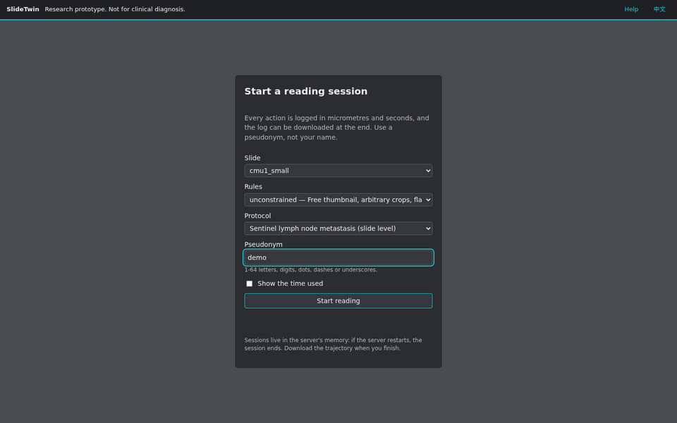

# SlideTwin（中文说明）

> **研究原型，不用于临床诊断。**

SlideTwin 是一个可以被 AI agent 操作的数字病理阅片器。人和 agent 在同一套规则下阅读同一张全切片图像（WSI）。

- 会话中看到的每个像素都来自一次有记录的操作（view / thumbnail / crop）。
- 位置和距离一律用微米，时间用虚拟时钟（秒）。
- 只用日志就能完整重放一次会话。

它支撑三类实验：

- **忠实性**：结论只能依赖记录在案的视野。
- **阴性覆盖证明**：“未见转移”必须附带覆盖证明。
- **空间测量**：大小和距离要在物理尺度上测量。



博客文章（中英双语）：[Introducing SlideTwin](https://wenhaozhang0066.github.io/SlideTwin/)。

## 安装与运行

需要 Python 3.12 或更高版本，运行在 Linux 上。

```bash
python3 -m venv .venv && . .venv/bin/activate
pip install "slidetwin[all]"        # 含全部读取器
```

`slidetwin` 命令：

```bash
slidetwin serve --demo                              # 下载 demo 的三张切片（0.9 GB）并启动服务
slidetwin check /path/to/slide.svs                  # 查看 SlideTwin 能从切片里读到什么
slidetwin manifest /path/to/slides -o manifest.yaml # 生成清单：不透明 id、哈希、格式，并列出拒绝原因
slidetwin serve --slides /path/to/slides --manifest manifest.yaml
slidetwin mcp --slides /path/to/slides --manifest manifest.yaml   # stdio 上的 MCP
slidetwin replay --demo logs/sessions/<id>.jsonl    # 回放一次阅片并报告差异
slidetwin fetch --demo                              # 只下载
```

`--demo` 把切片下载到 `./data/slides`（可用 `--slides` 指定其他目录）；`serve --demo` 下载完成后才开始监听。`serve` 默认监听 127.0.0.1:7860，在浏览器打开 http://localhost:7860/ 即可阅片。要让其他机器访问，加 `--host 0.0.0.0`，并把 `SLIDETWIN_ALLOWED_HOSTS` 设为它们使用的主机名或地址。`replay` 需要与阅片时相同的切片选项：`--demo`，或 `--slides` 加 `--manifest`。

本地 agent（例如 Claude Code）：`claude mcp add slidetwin -- /path/to/.venv/bin/slidetwin mcp --slides /path/to/slides --manifest /path/to/manifest.yaml --log-dir /path/to/logs`。请全部使用绝对路径，`slidetwin` 本身也要：agent 可能在任何目录下、且不在你的虚拟环境里启动它。阅片日志默认写在 `./logs`，可用 `--log-dir` 或 `SLIDETWIN_LOG_DIR` 改。规则档、协议和 demo 清单随包安装；`SLIDETWIN_CONFIG_DIR` 或工作目录下的 `configs/` 会替换它们。

## 开发

```bash
git clone https://github.com/wenhaozhang0066/SlideTwin.git && cd SlideTwin
pip install -e ".[dev]"
python scripts/fetch_test_data.py           # 五个 CC0 小测试切片（11 MB），存到 data/testdata
pytest -q
slidetwin fetch --only cmu1_small           # 开发服务器要打开的 CC0 切片
uvicorn slidetwin.api.main:app --reload --port 7860 --no-access-log
```

在浏览器打开 http://localhost:7860/ 即可阅片；界面默认英文，可随时切换为中文。

`bash scripts/ci_local.sh` 在本机运行 CI 的大部分检查：先下载较大的测试切片（约 300 MB），再运行 ruff、mypy、界面单元测试（需要 Node.js，没有则跳过）和覆盖率门槛为 100% 的 pytest。CI 另外还运行浏览器测试，并检查 wheel 和 Docker 镜像。

## 切片格式

SlideTwin 根据文件内容选择读取器。没有可信读取器的格式会被拒绝，并提示如何转换，绝不猜测。"实验性"格式只在合成文件上验证过，需要在清单里给该切片设置 `experimental: true` 才会打开。标 (openslide)、(slideio) 或 (isyntax) 的需要先安装对应扩展，例如 `pip install "slidetwin[openslide]"`；`"slidetwin[all]"` 安装全部扩展。

| 格式 | 文件 | 支持 | 拒绝或实验性 |
|---|---|---|---|
| Aperio SVS，以及 SVS 导出格式（Grundium、KFBio） | `.svs` | JPEG、JPEG 2000 | |
| Philips TIFF | `.tiff` | 明场 | |
| Huron TIFF | `.tif` | 明场 | |
| 通用金字塔 TIFF（libvips 等） | `.tif` | 结构规整、分辨率可信的金字塔 | 否则需要 `mpp_override` |
| Hamamatsu NDPI (openslide) | `.ndpi` | 明场 JPEG，焦平面 0 | 荧光、其他焦平面 |
| Hamamatsu VMS / VMU (openslide) | `.vms`/`.vmu` 及其列出的文件 | 单层 VMS | VMU 实验性 |
| 3DHistech MIRAX (openslide) | `.mrxs` 及同名文件夹 | 明场、单焦平面 | 荧光、JPEG XR 瓦片 |
| Sakura SVSlide (openslide) | `.svslide` | | 实验性 |
| DICOM WSI | 一个序列的文件夹，或其中一个层级文件 | JPEG、JPEG 2000（YBR_FULL_422） | JPEG XL、HTJ2K 实验性 |
| Zeiss CZI | `.czi` | 明场（JPEG XR、zstd），一个场景一张切片 | 荧光、z-stack、多文件 |
| Leica SCN | `.scn` | 单个明场区域 | 多区域、z-stack 实验性；荧光拒绝 |
| Trestle TIFF | `.tif` | 已在 CMU-1 上验证的结构 | |
| Ventana BIF | `.bif` | VENTANA DP 200，单个扫描区域 | 旧版 iScan 文件 |
| ARGOS AVS | `.avs` | 明场，可选 z-stack 的焦平面 | |
| OME-TIFF | `.ome.tif` | 交错存储的 RGB | 多通道、按平面存储、z-stack |
| Akoya QPTIFF | `.qptiff` | 明场 | 荧光 |
| Olympus VSI (slideio) | `.vsi` 及其 `_<name>_` 文件夹 | 明场 8 位 RGB，单焦平面；一个场景一张切片 | 荧光、16 位、z-stack |
| Philips iSyntax (isyntax) | `.isyntax` | 第 1 版，像素尺寸已知 | iSyntax 第 2 版 |
| Zeiss ZVI (slideio) | `.zvi` | | 暂时全部拒绝（还没有可验证的明场样本） |

暂不支持：荧光与多重标记图像、普通图片（JPEG、PNG、JPEG 2000），以及没有开源读取器的格式（SQRAY SDPC、UNIC TMAP、KFBio KFB、Motic MDS/MDSX、DYJ）。无论哪种格式，标签、宏观照片和内嵌缩略图都不会被读取。

## MCP 与 agent

每个会话动作同时也是 `/mcp`（streamable HTTP）上的一个 MCP 工具。任何支持 MCP 的客户端都可以用它阅片，包括 Claude Code：

```bash
claude mcp add --transport http slidetwin http://localhost:7860/mcp
```

其他客户端的接入命令以各自的官方文档为准。部署到公网域名时，把 `SLIDETWIN_ALLOWED_HOSTS` 设为该域名（默认只接受 localhost）。

基线 agent 在本地运行，通过 REST 或 MCP 连接服务器：

```bash
python -m slidetwin.agents serpentine --env http://localhost:7860 --slide cmu1_small
python -m slidetwin.agents llm --env http://localhost:7860 --slide cmu1_small   # 需要 pip install "slidetwin[llm]"，以及 ANTHROPIC_API_KEY 或 `ant auth login`
# 也可以用本地 vLLM 部署的开源模型（如 Qwen3-VL-8B-Instruct，需开启工具调用）：命令见英文 README
```

## 训练接口

训练时用 `slidetwin.env` 在你自己的进程里运行会话：不走 HTTP，不经 JPEG 编解码，规则、代价和日志与 REST、MCP 完全相同。动作是一个 dict：动作名加上它的 REST 请求体；每一步返回 RGB 数组形式的视野。下面的脚本读取一张 demo 切片：请在 `slidetwin fetch --demo` 存放切片的目录（`./data/slides` 所在目录）里运行。

```python
from slidetwin.env import Env, VecEnv, demo_manifest

if __name__ == "__main__":  # VecEnv 的工作进程会导入这个脚本：所有代码都放在这个保护之下
    with Env(demo_manifest()) as env:
        step = env.reset("c16_29f5ca")  # 首个视野，以及切片、任务和规则
        step = env.step({"action": "set_magnification", "mag": 10})
        step.image, step.cost_s, step.elapsed_s, step.done  # (1024, 1280, 3) uint8 数组, ...
        step = env.step({"action": "pan", "dx": 0.5, "dy": 0})
        step = env.step({"action": "set_magnification", "mag": 7})
        step.error  # 被拒绝（MAG_NOT_PRESET），格式与 REST 相同

    with VecEnv(8, manifest=demo_manifest()) as vec:  # 每个环境一个工作进程
        steps = vec.reset(["c16_29f5ca"] * 8)
        steps = vec.step([{"action": "view"}] * 8)
```

环境不给奖励：标准答案从不进入任何一步，由训练代码自己给阅片打分（例如用 `slidetwin.eval`）。不设 `log_dir` 就不写日志；设了之后每个 episode 都写出与网页会话相同、可回放的轨迹。`image="jpeg"` 返回 REST 和 MCP 提供的 JPEG。`scripts/bench_env.py` 测速度：在一张 CAMELYON16 切片上，单个环境每秒 32 个动作，8 个工作进程每秒 182 个（共享的 64 核节点）。

## 评测与部署

- 评测工具在 `slidetwin/eval`，只在评测中读取 CAMELYON16 标注。[docs/EVALUATION.md](docs/EVALUATION.md) 报告了基线 agent 在 `configs/slides/manifest.yaml` 中五张 CAMELYON16 切片上的结果（共 5.3 GB；demo 只含其中一张），复现步骤见该文件末尾。
- Docker：先构建镜像，`docker build -t slidetwin .`；`docker run -p 7860:7860 slidetwin` 会先下载 demo 的公开切片（`configs/slides/demo.yaml`，0.9 GB，校验 sha256），下载完成后开始服务：一张 CC0 小样本和两张 CAMELYON16 淋巴结切片（一张阴性，一张有微转移）。读取自己的切片时：
  - 把切片目录挂载到 `/data/slides`，把 manifest 挂载到 `/data/manifest.yaml`，并设置 `SLIDETWIN_MANIFEST=/data/manifest.yaml` 和 `SLIDETWIN_FETCH_SLIDES=0`；
  - 容器以 uid 1000 运行，这个用户必须能读取切片；
  - 阅片日志写在容器内的 `/tmp/slidetwin/logs`，容器删除后随之消失；要保留就挂载一个 uid 1000 可写的目录到这里。

  完整命令见英文 README 的 Deployment 一节。`configs/slides/manifest.yaml` 包含 CC0 小样本和评测用的五张切片。
- 会话保存在内存中，服务重启会结束会话，请在结束时下载轨迹。
- GitHub Codespaces（`.devcontainer/`）：
  1. 可选，在创建之前：到 **Settings > Codespaces** 调大 **Default idle timeout**（默认 30 分钟，最长 240 分钟）。这个设置只对之后新建的 codespace 生效。
  2. 在仓库页面选 **Code > Codespaces > Create codespace on main**。首次启动需要几分钟（安装 SlideTwin），随后在后台下载 demo 切片（0.9 GB）。之后每次启动都会自动运行服务（端口 7860），终端随后显示服务日志。
  3. 终端打印 `SlideTwin is running: https://<name>-7860.app.github.dev` 后打开这个地址。默认只有你自己能打开。如果同时提示切片仍在下载，每张切片下载完成后即可打开（一两分钟）。
  4. 要分享给别人，在 **Ports** 面板右键 7860，选 **Port Visibility > Public**。codespace 每次重启后端口都会变回私有，所以每次演示前都要重新设置。

  访客第一次打开时会看到 GitHub 的提示页（说明这是别人 codespace 的端口），点 **Continue** 即可进入。MCP 客户端用 `https://<name>-7860.app.github.dev/mcp`。codespace 停止后，这个地址只返回空白页。

  访客的访问不算活动：从你最后一次操作起，超过闲置时间 codespace 就会停止，最长连续运行 12 小时。在 github.com/codespaces 重新启动后，服务地址不变，切片不用重新下载；新建的 codespace 地址会变。服务日志在 `logs/server.log`。

  codespace 占用账号的每月额度：GitHub Free 120 核时（默认 2 核机器约 60 小时），Pro 180 核时。只要它存在，还会占用约 4 GB 存储额度（Free 每月 15 GB-month）。关闭浏览器标签页并不会停止它：演示结束后请停止 codespace，长期不用时删除。GitHub 的条款允许把 codespace 用于开发和测试（比如短期演示），不允许当作长期公开服务。
- 病理专家试点见 [docs/PILOT.md](docs/PILOT.md)；代价参数可用 `python scripts/calibrate_costs.py LOGS --fitted fitted.yaml` 从人类日志（`LOGS` 为轨迹文件或目录）拟合。

## 文档

- 规格书：[docs/SPEC.md](docs/SPEC.md)
- 决策记录：[docs/DECISIONS.md](docs/DECISIONS.md)
- 数据来源与许可：[docs/DATA_LICENSES.md](docs/DATA_LICENSES.md)

## 数据

本仓库不包含任何切片、患者数据或公司数据。切片从 `SLIDETWIN_SLIDE_DIR` 读取，并在清单中列出（`configs/slides/demo.yaml`、`configs/slides/manifest.yaml`）。

## 引用

如果你的工作用到了 SlideTwin，请引用：

```bibtex
@software{zhang2026slidetwin,
  author  = {Zhang, Wenhao and Zhou, Zhongliang and Li, Sheng},
  title   = {SlideTwin: an agent-operable whole-slide image viewer simulator},
  year    = {2026},
  version = {0.1.1},
  url     = {https://github.com/wenhaozhang0066/SlideTwin}
}
```

[CITATION.cff](CITATION.cff) 中是同一条引用（即 GitHub 页面上的 “Cite this repository”）。

## 许可

代码采用 Apache-2.0；数据各自沿用原始许可。
